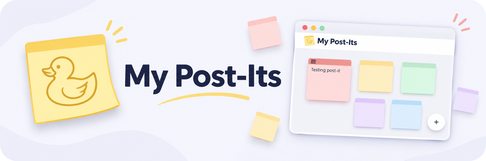
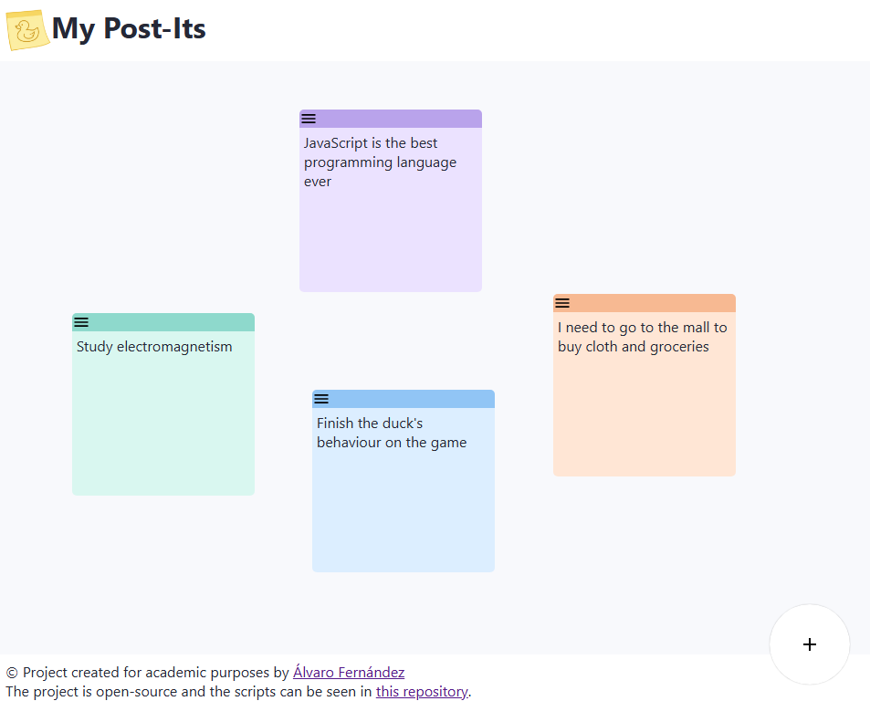

<div align="center">


**Your thoughts, reminders, and little ideas. All in one place.**

A colorful web application for creating, editing, customizing, and organizing digital sticky notes.

Built with **HTML, CSS, and vanilla JavaScript**, with Firebase Authentication and cloud-based note storage.

**[Try the live application](https://zanedevv.github.io/MyPost-Its/)**

</div>

---

## About the Project

**My Post-Its** is an open-source web application developed as a class project. Inspired by physical sticky notes, it provides a simple workspace where users can create reminders and ideas, change note colors, and arrange notes freely.

Notes and their positions are saved between sessions. Users can sign in and access their notes from different devices, with changes synchronized through the application's cloud storage.

The project focuses on straightforward interactions, a clean interface, and modular JavaScript rather than a complex set of productivity tools.

---

## Features

| Feature | Description |
|---|---|
| **Create notes** | Click the floating **+** button in the **bottom-left** corner. |
| **Edit text** | Double-click a note to edit its contents. |
| **Change colors** | Use the three-line menu at the top of a note to select a color. |
| **Drag and drop** | Move notes freely around the workspace. |
| **Save positions** | Note positions are preserved between sessions. |
| **Swipe to delete** | Move or swipe a note horizontally to delete it. |
| **User authentication** | Sign in with email and password or Google through Firebase Authentication. |
| **Cloud persistence** | Saved notes remain available after reopening the application. |
| **Cross-device synchronization** | Access and synchronize notes using the same account on different devices. |

### Available Note Colors

My Post-Its provides ten colors for customizing individual sticky notes.

The colors are defined in `src/scripts/post_its/colorList.js`:

- Yellow
- Pink
- Purple
- Green
- Blue
- Peach
- Orange
- Mint
- Coral
- Gray

```javascript
export const colorList = [
    "yellow",
    "pink",
    "purple",
    "green",
    "blue",
    "peach",
    "orange",
    "mint",
    "coral",
    "gray"
];
```

These colors allow users to visually distinguish notes and organize their information according to their preferences.

---

## Application Preview

<div align="center">



*Main workspace of My Post-Its.*

</div>

The interface includes a navigation header, a central workspace for notes, a floating **+** button in the bottom-left corner, controls on individual notes, and a footer with project information.

The design prioritizes simplicity, allowing users to focus on organizing their ideas without unnecessary navigation.

---

## How to Use

### 1. Sign In

Access the application and authenticate using one of the supported methods:

- Email and password.
- Google account.

Firebase Authentication manages user authentication.

### 2. Create a Note

1. Locate the floating **+** button in the bottom-left corner.
2. Click the button to create a new sticky note.
3. The note will appear in the workspace.
4. Double-click it to enter or modify its text.

### 3. Edit a Note

1. Locate the note you want to edit.
2. Double-click the note.
3. Modify its text.

### 4. Move a Note

1. Click and hold the note.
2. Drag it to the desired position.
3. Release the mouse button.

The position is saved, preserving the workspace arrangement between sessions.

### 5. Change a Note's Color

1. Locate the three-horizontal-line menu at the top of the note.
2. Click the menu.
3. Select one of the ten available colors.
4. The note's appearance will change accordingly.

### 6. Delete a Note

1. Locate the note you want to delete.
2. Perform a horizontal swipe gesture.
3. The note will be deleted from the workspace.

### 7. Access Notes from Another Device

1. Open the application on another device.
2. Authenticate using the same account.
3. Access your previously saved notes.
4. Continue working with your synchronized workspace.

---

## Technologies Used

The application is developed using standard web technologies and cloud services.

| Technology | Purpose |
|---|---|
| **HTML5** | Defines the application structure and content. |
| **CSS3** | Handles layout, visual styling, and the appearance of sticky notes. |
| **Vanilla JavaScript** | Implements note behavior, mouse interactions, and application logic. |
| **Firebase Authentication** | Provides email/password and Google authentication. |
| **Cloud Firestore** | Provides cloud-based data persistence. |
| **Git** | Supports version control and development. |
| **GitHub** | Hosts the source code repository. |
| **GitHub Pages** | Hosts the publicly accessible application. |

> **Database clarification:** MongoDB was also mentioned during project documentation, but its use and relationship to Firestore have not been verified. It is therefore not listed as a confirmed dependency. This section should be updated if the application actually uses both databases.

---

## Project Structure

The source code follows a modular structure, separating configuration, database operations, note management, and mouse interactions.

```text
src/
├── img/
│   ├── banner.png
│   └── overview.png
│
└── scripts/
    ├── config/
    │   └── post_it.js
    │
    ├── database/
    │   ├── authenticator.js
    │   ├── database.js
    │   ├── firebase_config.js
    │   └── firebase.js
    │
    ├── mouse/
    │   ├── mouse_dragger.js
    │   ├── mouse_swipe.js
    │   └── mouse_text_changer.js
    │
    ├── post_its/
    │   ├── colorList.js
    │   ├── colors.js
    │   ├── post_its_map.js
    │   └── PostIt.js
    │
    ├── main.js
    └── mouse.js
```

This structure represents the identified source files rather than the entire repository.

### Module Overview

| Module | Main Responsibility |
|---|---|
| `config/post_it.js` | Configuration related to sticky notes. |
| `database/authenticator.js` | User authentication logic. |
| `database/database.js` | Database operations and persistence. |
| `database/firebase_config.js` | Firebase configuration. |
| `database/firebase.js` | Firebase service integration. |
| `mouse/mouse_dragger.js` | Drag-and-drop functionality. |
| `mouse/mouse_swipe.js` | Horizontal swipe deletion. |
| `mouse/mouse_text_changer.js` | Mouse-based text editing. |
| `post_its/colorList.js` | Defines the available note colors. |
| `post_its/colors.js` | Handles color-related functionality. |
| `post_its/post_its_map.js` | Note collection or mapping logic. |
| `post_its/PostIt.js` | Represents individual sticky notes and their behavior. |
| `main.js` | Application initialization. |
| `mouse.js` | General mouse interaction handling. |

The exact responsibilities of individual modules have been inferred from their filenames and the confirmed application features.

---

## Getting Started

Follow these instructions to obtain a local copy of the project.

### Prerequisites

Before running the application, make sure you have:

- A modern web browser.
- [Git](https://git-scm.com/) installed.
- A local web server if required by the application's JavaScript modules.
- Appropriate Firebase configuration and permissions for the instance you want to run.

### Installation

**1. Clone the repository**

Open a terminal and execute:

```bash
git clone https://github.com/ZaneDevv/MyPost-Its.git
```

**2. Navigate to the project directory**

```bash
cd MyPost-Its
```

**3. Configure the application**

Review the Firebase configuration included in the project.

If you intend to run an independent instance, configure an appropriate Firebase project, the required authentication providers, and database access.

**4. Run the application locally**

The exact project-specific startup procedure has not yet been verified.

If the project is served as a static website with an `index.html` file in the root directory, one possible method is to start a local web server:

```bash
python3 -m http.server 5500
```

**5. Open the application**

Navigate to:

```text
http://localhost:5500/
```

This is an example static-server command, not a verified project-specific requirement.

Depending on the Firebase configuration, additional setup may be necessary for authentication and database operations.

Never commit private credentials or service-account keys to the repository.

### Live Demo

The application is publicly available through GitHub Pages.

**[Open My Post-Its](https://zanedevv.github.io/MyPost-Its/)**

---

## Application Architecture

My Post-Its uses a modular frontend architecture organized around three main responsibilities.

### User Interface

The interface is built using HTML and CSS.

It provides the workspace, note elements, menus, and controls used to interact with the application.

### Application Logic

Vanilla JavaScript modules implement the application's core functionality.

These include:

- Note creation and management.
- Text editing.
- Drag-and-drop movement.
- Swipe-to-delete interactions.
- Note color selection.
- Mouse event handling.

The modular structure separates different responsibilities, making the application easier to maintain and extend.

### Authentication and Persistence

The database-related modules manage authentication and cloud data operations.

Firebase Authentication provides email/password and Google sign-in.

The persistence system stores the information needed to restore the user's workspace, including saved notes and their positions.

Users can access their notes from different devices using the same account.

### Security Considerations

The README does not establish how Firestore security rules are configured.

Before deploying or sharing a Firebase-backed application, verify that authenticated users can access only the data they are authorized to read or modify.

Sensitive credentials and service-account keys should never be committed to a public repository.

---

## Project Objectives

### General Objective

Develop an interactive web application that allows users to create, customize, and organize digital sticky notes through an intuitive graphical interface, with authentication and persistent cloud-based storage.

### Specific Objectives

1. Design a clean and intuitive user interface.
2. Implement sticky-note creation, editing, and deletion.
3. Enable free positioning of notes through drag-and-drop interactions.
4. Preserve note positions between sessions.
5. Provide color customization for individual notes.
6. Implement gesture-based interactions.
7. Integrate user authentication.
8. Support cloud-based persistence and cross-device synchronization.
9. Organize application logic into maintainable JavaScript modules.
10. Apply web development concepts in a practical academic project.

---

## Development and Testing

My Post-Its was developed as a practical exercise in frontend development, JavaScript programming, user interaction, and cloud service integration.

The application focuses on implementing essential functionality while maintaining a simple interface.

### Functional Verification

The following table describes the expected behavior of the application's main features.

| Feature | Expected Behavior |
|---|---|
| Note creation | Clicking the **+** button creates a new note. |
| Text editing | Double-clicking allows modification of note text. |
| Dragging | Notes can be moved freely around the workspace. |
| Position persistence | Notes retain their saved positions between sessions. |
| Color selection | Users can select one of ten available colors. |
| Note deletion | A horizontal swipe removes a note. |
| Authentication | Users can sign in using supported Firebase methods. |
| Data persistence | Notes remain available after reopening the application. |
| Synchronization | Notes can be accessed and synchronized across devices. |

These are expected behaviors based on the implemented features, not results from an automated test suite.

The project does not currently include dedicated automated testing.

---

## Current Scope and Limitations

The current version focuses on the essential digital sticky-note experience.

The application does not currently provide:

- Note resizing.
- Dedicated note titles.
- Search and filtering.
- Automatic note sorting.
- Undo or redo functionality.
- A dedicated automated testing system.
- Specifically implemented mobile-responsive features.
- Specifically implemented accessibility features.

These limitations reflect the application's current academic scope and focus on simplicity.

---

## Academic Purpose

My Post-Its was developed as an educational project to apply web development concepts in a practical environment.

The development process provides experience in:

- Designing interfaces using HTML and CSS.
- Programming interactive behavior with JavaScript.
- Working with DOM events and mouse interactions.
- Organizing JavaScript code into modules.
- Integrating third-party services.
- Implementing user authentication.
- Managing persistent application data.
- Working with Git and GitHub.
- Deploying a web application using GitHub Pages.
- Documenting software for users and developers.

The project is intended for educational purposes and as a reference for students and developers interested in frontend development.

---

## License

This project is licensed under the **MIT License**.

You are free to use, modify, and distribute the source code under the conditions described in the license.

See the [LICENSE](LICENSE) file for the complete terms.

---

## Author

**Álvaro Fernández**

My Post-Its was developed as an academic project to practice and demonstrate web development concepts, including frontend programming, interactive interfaces, authentication, and cloud data persistence.

The source code is available in the project's GitHub repository for educational and reference purposes.

---

<div align="center">

**My Post-Its — Your ideas, your space.**

Made with HTML, CSS, JavaScript, and Firebase.

</div>
