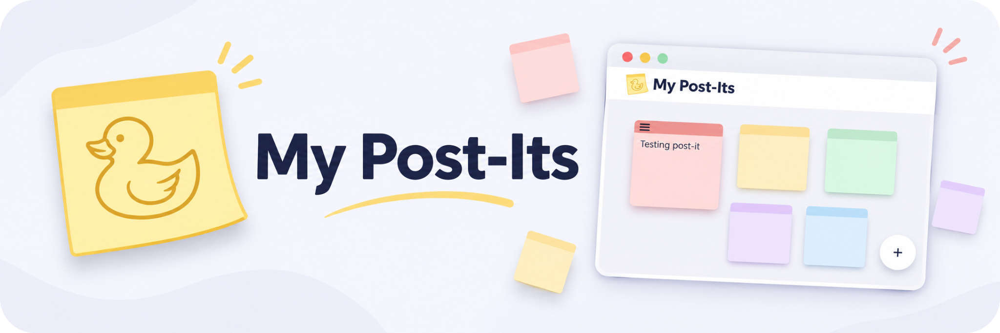
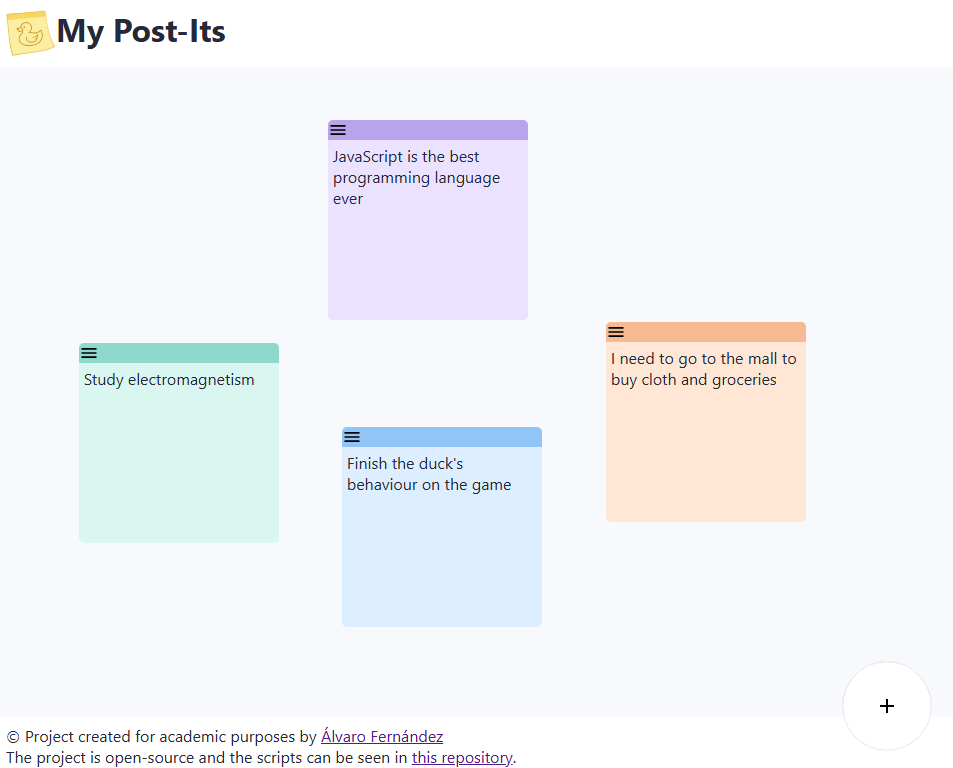

<div align="center">

  
  
  
  
  

**Your thoughts, reminders, and little ideas. All in one place.**

A simple, colorful, and easy-to-use web application for creating and organizing digital sticky notes.
</div>

## About the Project

**My Post-Its** is a web application developed as an academic project. Its main purpose is to provide a simple and accessible environment where users can create and organize digital sticky notes directly from their browsers.

The application is inspired by traditional sticky notes, which are commonly used to write down reminders, ideas, and short pieces of information. My Post-Its brings this concept to a digital environment through an intuitive interface.

The project focuses on simplicity, usability, and a clean visual design. Users can interact with their notes without having to navigate through complicated menus or unnecessary features.

In addition to its practical purpose, this application was developed to apply and improve knowledge related to web development, including interface design, programming logic, and user interaction.

---

## Features

The application provides a set of basic features designed to make note management straightforward.

| Feature | Description |
|---------|-------------|
| **Create Notes** | Add new sticky notes to the workspace. |
| **Note Management** | Manage notes through a simple interface. |
| **Visual Organization** | Display notes in a clear and organized workspace. |
| **Colorful Design** | Use a visual style inspired by traditional sticky notes. |
| **Simple Navigation** | Access the application's functionality without complicated menus. |
| **Web Interface** | Use the application directly through a web browser. |

The main objective is to maintain a balance between functionality and simplicity, ensuring that the interface remains easy to understand.

---

## Application Preview

The following image shows the main interface of My Post-Its.

<div align="center">



*Main workspace of the application.*

</div>

The interface consists of a navigation header, a central workspace where the notes are displayed, and a button for creating new notes.

Each sticky note is represented by a rectangular element with a colored header, maintaining a visual appearance similar to physical sticky notes.

The application also includes a footer containing information about the project and its source code.

---

## Getting Started

To obtain a local copy of the project, follow these instructions.

### Prerequisites

Before running the application, make sure you have:

- A modern web browser.
- Git installed on your computer.
- The development tools and dependencies required by the project.

### Installation

**1. Clone the repository**

Open a terminal and execute:

```bash
git clone https://github.com/YOUR_USERNAME/YOUR_REPOSITORY.git
```

**2. Navigate to the project directory**

```bash
cd YOUR_REPOSITORY
```

**3. Configure the project**

Install the necessary dependencies and complete any configuration required by the application.

**4. Run the application**

Start the application using the appropriate command for the project's development environment.

Once the application is running, open the local address provided by the development server in your browser.

---

## How to Use

My Post-Its has been designed so that users can understand its basic functionality without requiring extensive instructions.

### Creating a Note

1. Open the application.
2. Locate the circular **+** button in the bottom-right corner.
3. Click the button to create a new sticky note.
4. Enter the desired text.
5. View the note in the main workspace.

### Managing Notes

The workspace displays the created notes and allows users to interact with them through their available controls.

The interface aims to make these interactions as simple as possible, allowing users to focus on the information contained in their notes.

---

## Interface Design

The design of My Post-Its follows a minimalist approach.

The main goal is to create an interface where the most important elements are clearly visible and accessible.

### Color Palette

The application uses a combination of neutral backgrounds and soft colors.

The main workspace has a light background that provides contrast with the sticky notes, making them easier to identify.

Colored headers help distinguish individual notes and provide a visual reference to traditional sticky notes.

### Layout

The interface is divided into three main sections:

**Header**

The header is located at the top of the page and displays the application's logo and name.

**Workspace**

The workspace occupies most of the screen and contains the sticky notes created by the user.

**Footer**

The footer provides information about the academic purpose of the project and includes references to its author and source code.

### User Interaction

The application uses recognizable interface elements to simplify navigation.

For example, the floating button with the **+** symbol provides a clear way to create new notes.

The general layout avoids unnecessary elements so that users can focus on the main functionality.

---

## Project Objectives

The development of My Post-Its was guided by several objectives related to both the application's functionality and the learning process.

### General Objective

Develop a functional web application that allows users to create and manage digital sticky notes through a simple graphical interface.

### Specific Objectives

1. Design a clear and intuitive user interface.
2. Implement the basic functionality required for creating and managing notes.
3. Apply web development concepts in a practical project.
4. Organize the application into maintainable components.
5. Improve the user experience through an accessible layout.
6. Practice identifying and solving problems during the development process.
7. Document the project to explain its purpose, functionality, and structure.

These objectives help establish the scope of the application and provide a reference for evaluating its development.

---

## Development Process

The project was developed by following the main stages involved in creating a web application.

### 1. Planning

The first stage consisted of defining the purpose of the application and identifying its essential features.

The main requirement was to create a workspace where users could add and interact with digital notes.

### 2. Interface Design

The next step was to establish the visual structure of the application.

This included designing the header, workspace, sticky-note components, and controls used for interacting with notes.

Special attention was given to keeping the layout simple and consistent.

### 3. Implementation

During this stage, the application's interface and functionality were developed.

The different components were connected so that users could interact with the application through the browser.

### 4. Testing

Testing is an important part of the development process.

The application should be checked to ensure that its main features behave as expected and that the interface displays correctly.

Some important aspects to verify include:

- The creation of new notes.
- The display of note content.
- The behavior of interactive elements.
- The layout of the workspace.
- The general usability of the application.

### 5. Documentation

The final stage involves documenting the application's purpose, features, and usage.

This README provides an overview of the project and helps other developers or students understand its structure and objectives.

---

## Project Structure

The source code is organized into different files and directories according to their responsibilities.

The project includes resources associated with the interface, application logic, configuration, and documentation.

| Component | Purpose |
|-----------|---------|
| **Source Code** | Contains the implementation of the application. |
| **Styles** | Defines the appearance of the interface and its elements. |
| **Assets** | Contains images, icons, and other static resources. |
| **Configuration** | Stores the settings required by the application. |
| **Documentation** | Explains the functionality and purpose of the project. |

Separating these resources helps improve code organization and makes future modifications easier.

---

## Academic Purpose

This project was created for educational purposes as part of the process of learning and applying web development concepts.

Its development provides practical experience in areas such as interface design, programming, application structure, and user interaction.

Working on this application also helps develop important skills, including problem-solving, debugging, code organization, and documentation.

The main focus of the project is not to create a commercial product, but to demonstrate the ability to develop a functional application based on a defined set of requirements.

---

## License

This project is licensed under the MIT License.

You are free to use, modify, and distribute the source code, provided that
the original copyright and license notice are included.

See the [LICENSE](LICENSE) file for more information.

---

## Author

**Álvaro Fernández**

My Post-Its was developed as an academic project to practice and demonstrate web development concepts.

The source code is available in this repository for reference and educational purposes.